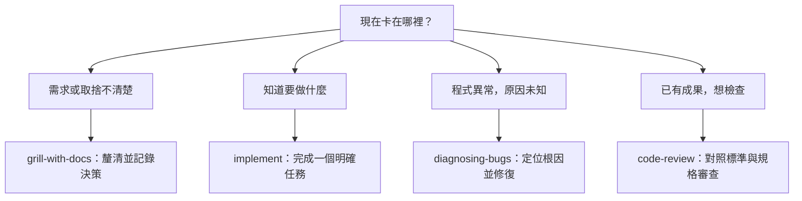

# AI Agent Config

Maintain MCP servers and Agent Skills once, then install the same definitions
for Claude Code and Codex. The public Git repository is the source of truth and
can be run directly with Node.js on Windows, macOS, and Linux.

快速閱讀：[Skills 使用指南](#skills-使用指南) · [架構設計的分界](#架構調查與模組設計的分界) · [需要明確點名的-skills](#需要明確點名的-skills)

## Install

Run this command from any terminal with Node.js 18 or newer:

```sh
npx --yes github:InternetED/ai-agent-config
```

Like the `skills` installer, this asks where the files should live instead of
silently choosing for you:

| Scope | Skills | Codex MCP | Claude Code MCP |
| --- | --- | --- | --- |
| User | `~/.agents/skills`, `~/.claude/skills` | `~/.codex/config.toml` | `~/.claude.json` |
| Project | `.agents/skills`, `.claude/skills` | `.codex/config.toml` | `.mcp.json` |

For scripts or CI, choose the scope explicitly:

```sh
npx --yes github:InternetED/ai-agent-config --scope user
npx --yes github:InternetED/ai-agent-config --scope project
```

Project scope defaults to the current directory. Use `--project PATH` to target
another project. Restart an agent session that was already open if it does not
detect new Skills immediately.

The installer copies managed Skills and merges managed MCP entries without
replacing unrelated settings. It rejects unmanaged MCP name collisions and
validates configuration and Skill destinations before writing. It creates
backups before changing MCP configuration and stores environment-variable names,
never credentials.

## Skills 使用指南

**不用記住所有 skill。先說清楚目標、目前的未知，以及這次要交付什麼。**
下列指南依本庫目前 49 個 skills 整理；名稱連結指向各自的完整使用規則。
Skills 可以組合：`implement` 管單一任務交付，過程可搭配 `tdd`、
`code-review` 與驗證，不代表每次都要手動依序呼叫。

### 先判斷現在卡在哪裡



- **小而明確的修改**：直接實作與驗證，不必先訪談、寫規格、拆票。
- **大方向不明、會跨多次 session**：先 `wayfinder` 探索決策；方向收斂後才寫規格。
- **需求已收斂的大型功能**：`to-spec` 整理規格 → `to-tickets` 將已接受的規格拆成垂直切片 →
  每張用 `implement`，或整份用 `implement-spec` 協調。
- **不知道選哪個**：請 `ask-matt` 建議最小流程。它目前是主要工程流程導覽，
  不是完整的 49 個 skills 索引；已列入 `retro`、`wait-what`，尚未列入
  `software-factory`、`chief-of-staff`、`loop-me`、`show-me`、`rtk`。
  這些特殊需求可直接點名；`find-skills` 則是找外部能力，不是選本庫流程。

### 怎麼提出請求

不必依賴特定客戶端的斜線指令；可以直接說「使用 `skill-name`，幫我……」。
是否支援 `/skill-name` 及如何載入，以客戶端為準。不要只給 skill 名稱而省略目標：

```text
使用 grill-with-docs。
目標：新增團隊通知功能。
未知：還沒決定通知誰、何時通知。
這次交付：釐清需求並記錄決策，不要實作。
```

```text
使用 implement。
目標：新增「全部標為已讀」。
已知：需求已定案，沿用現有權限與資料存取方式。
這次交付：完成修改並驗證；不要順便重構，也不要提交。
```

```text
使用 diagnosing-bugs。
問題：標為已讀後重新整理，狀態又變成未讀。
這次交付：找出根因、修復並驗證，不要只繞過畫面上的症狀。
```

### 探索、需求與決策

| Skill | 使用場景／交付 | 邊界：什麼時候不要用 |
| --- | --- | --- |
| [ask-matt](Skills/ask-matt/SKILL.md) | 不確定該選哪個工程流程，請它導覽 | 已選定 skill 就直接執行；不負責搜尋外部 skills |
| [setup-matt-pocock-skills](Skills/setup-matt-pocock-skills/SKILL.md) | 首次配置 issue tracker、triage 標籤與領域文件慣例 | 不是安裝 skills；已配置的 repo 不必每次重跑 |
| [ed-brainstorm](Skills/ed-brainstorm/SKILL.md) | 明確要求腦力激盪，將模糊構想收斂成決策摘要 | 不實作、不發布規格或 tickets；僅明確要求時使用 |
| [wayfinder](Skills/wayfinder/SKILL.md) | 跨 session、方向未知的大型工作，建立與釐清決策地圖 | 不取代已明確的執行計畫，也不直接建置產品 |
| [research](Skills/research/SKILL.md) | 查官方文件、API 或第一手資料，留下附引用的 Markdown | 不以研究代替需求決策、規格或實作 |
| [prototype](Skills/prototype/SKILL.md) | 用可丟棄的程式回答 UI 或狀態邏輯的設計問題 | 不是正式功能或持久抽象 |
| [grilling](Skills/grilling/SKILL.md) | 壓力測試計畫、觀點與假設的訪談核心 | 不寫檔、不起草交付物、不實作 |
| [grill-me](Skills/grill-me/SKILL.md) | 不需工作目錄或文件紀錄的追問 | 需要留下詞彙表或 ADR 時用 `grill-with-docs` |
| [grill-with-docs](Skills/grill-with-docs/SKILL.md) | 在 repo 中釐清需求，並留存詞彙表與適用的 ADR | 不只是口頭訪談，也不是實作指令 |
| [domain-modeling](Skills/domain-modeling/SKILL.md) | 定義領域術語、整理 `GLOSSARY.md` 與重要決策 ADR | 不負責實作已定案任務 |
| [to-questionnaire](Skills/to-questionnaire/SKILL.md) | 缺少的知識在第三者手上，製作供對方填答的問卷 | 不是直接訪談眼前使用者，也不替對方猜答案 |

### 規格、實作、審查與交付

| Skill | 使用場景／交付 | 邊界：什麼時候不要用 |
| --- | --- | --- |
| [to-spec](Skills/to-spec/SKILL.md) | 將充分討論的內容整理並發布為規格 | 不藉此默默決定尚未收斂的需求，也不拆 tickets |
| [to-tickets](Skills/to-tickets/SKILL.md) | 把已接受的規格拆成可驗收的端到端切片及依賴關係 | 不處理開放式構想、不直接實作 |
| [triage](Skills/triage/SKILL.md) | 分類、評估外來 issue／PR，準備可執行摘要 | 不重複分流 `to-tickets` 已備妥的票，也不實作 |
| [implement](Skills/implement/SKILL.md) | 完成一個範圍明確的任務，包含驗證與審查 | 不做開放式設計或多票券工作樹整合；不自動提交 |
| [implement-spec](Skills/implement-spec/SKILL.md) | 依多票券依賴圖協調代理與工作樹，整合到單一分支 | 單一小任務用 `implement`；不自動授權 push 或合併 |
| [diagnosing-bugs](Skills/diagnosing-bugs/SKILL.md) | 對原因未知的錯誤、間歇失敗或效能問題定位並修復 | 原因已知的小修不必啟動完整診斷 |
| [tdd](Skills/tdd/SKILL.md) | 以一次一個行為的紅燈→綠燈循環實作 | 不取代未知根因調查或架構設計 |
| [code-review](Skills/code-review/SKILL.md) | 對照 repo 標準與原規格審查 branch／PR／WIP diff | 不取代執行驗證或安全專項審查 |
| [security-review](Skills/security-review/SKILL.md) | 檢查權限、輸入、秘密等安全風險 | 不是一般風格審查，也不保證全面安全 |
| [verification-before-completion](Skills/verification-before-completion/SKILL.md) | 在宣稱完成、修復、通過或提交／PR 前取得新鮮驗證證據 | 純探索或假設不需要完成關卡；不代表每次跑全套測試 |
| [ce-commit](Skills/ce-commit/SKILL.md) | 整理並建立適當的本地 commits | 不 push、不開 PR、不改寫已發布歷史 |
| [pr](Skills/pr/SKILL.md) | 撰寫／修訂 PR 說明，呈現變更、驗證證據與合併風險 | 不取代驗證，不自行解除 Draft 或合併 |

### 架構調查與模組設計的分界

**`improve-codebase-architecture` 決定「哪裡值得改」；
`codebase-design` 決定「這一塊該怎麼設計」。**

| Skill | 起點與工作 | 產出與邊界 |
| --- | --- | --- |
| [improve-codebase-architecture](Skills/improve-codebase-architecture/SKILL.md) | 架構有摩擦，但還沒選定改善點；調查指定範圍或變更熱點，比較候選 | 視覺化 HTML 報告、改善優先建議，再討論選中的方向；不直接全面重構 |
| [codebase-design](Skills/codebase-design/SKILL.md) | 已知要改善的模組；設計介面、責任、依賴接縫與測試邊界 | 設計取捨與方案；不是全庫普查，也不直接實作任務 |

例如，對本庫提出以下請求（僅為使用示例，不代表目前存在這些問題）：

- 「同步功能難以理解，先找最值得改善的地方」→ `improve-codebase-architecture`。
- 「我確定要整理 overlay 模組，設計一個隱藏覆蓋與合併細節的小介面」→ `codebase-design`。
- 「overlay 設計已確認，請改好並驗證」→ `implement`。

兩者共用的目標是**小介面隱藏足夠行為，讓修改與驗證集中**，不是把程式拆成更多檔案。
有時最好的改善是合併零碎模組、刪除沒有隱藏複雜度的轉呼叫層。

### UI、協作與環境工具

| Skill | 使用場景／交付 | 邊界：什麼時候不要用 |
| --- | --- | --- |
| [frontend-design](Skills/frontend-design/SKILL.md) | 建立／改造產品 UI 的視覺方向、排版與互動 | 不是單純操作網站或探索狀態邏輯 |
| [agent-browser](Skills/agent-browser/SKILL.md) | 操作網站、填表、截圖、擷取資料與瀏覽器 QA | 不替產品決定視覺方向；CLI 與瀏覽器 runtime 需另行安裝 |
| [handoff](Skills/handoff/SKILL.md) | 寫可攜式交接文件，供新 session、其他工具或同事接續 | 不立即啟動背景代理 |
| [claude-handoff](Skills/claude-handoff/SKILL.md) | 整理上下文並立即啟動 `claude --bg` 接手 | 不是留給未來使用的交接檔；需要 Claude CLI 支援 |
| [wizard](Skills/wizard/SKILL.md) | 為只有人能完成的憑證、後台設定或一次性切換製作互動式 Bash 精靈 | 代理能自行完成的步驟不轉嫁給人 |
| [find-skills](Skills/find-skills/SKILL.md) | 搜尋、評估並依意願安裝外部 skills | 選本庫既有工作流程用 `ask-matt` |
| [manage-ai-agent-config](Skills/manage-ai-agent-config/SKILL.md) | 維護本權威庫的 Skills、MCP 定義、來源與同步 | 不手改已安裝的 agent 副本 |
| [writing-for-agents](Skills/writing-for-agents/SKILL.md) | 編寫 skills、`AGENTS.md` 等代理文件的結構與指令 | 不負責來源登記、同步或產品功能實作 |
| [setup-ts-deep-modules](Skills/setup-ts-deep-modules/SKILL.md) | 用 dependency-cruiser 強制 TypeScript 套件公開入口與內部邊界 | 不適用非 TypeScript repo，也不只是討論設計 |
| [setup-pre-commit](Skills/setup-pre-commit/SKILL.md) | 設定 Husky、lint-staged、格式化與既有品質檢查 | 不是代理命令的安全攔截器 |
| [git-guardrails-claude-code](Skills/git-guardrails-claude-code/SKILL.md) | 用 Claude Code hook 攔截特定危險 Git 命令，包含 push | 不適用其他代理環境，也不取代人工審查 |
| [migrate-to-shoehorn](Skills/migrate-to-shoehorn/SKILL.md) | 整理部分／刻意無效的 TypeScript 測試資料型別斷言 | 不把 shoehorn 引入正式產品程式碼 |

### 需要明確點名的 skills

以下 7 個在本庫設有 `disable-model-invocation: true`。請明確要求使用；
客戶端如何呈現及執行此限制依其支援而定。**推薦一個 skill，不等於已授權啟用它。**
安裝 skill 也不等於安裝外部工具、設定排程或啟動服務。

| Skill | 使用場景與呼叫範例 | 邊界 |
| --- | --- | --- |
| [software-factory](Skills/software-factory/SKILL.md) | 「用 software-factory，設計從 GitHub issue 到代理實作、審查與人工核准的系統。」 | 設計軟體工廠的任務與服務，不代表已建置、部署或實作個別 ticket |
| [chief-of-staff](Skills/chief-of-staff/SKILL.md) | 「用 chief-of-staff，在這個長 session 協調遷移的調查、實作與驗證。」 | 現在協調子代理工作，不是跨 session 常駐背景服務 |
| [loop-me](Skills/loop-me/SKILL.md) | 「用 loop-me，把每週依賴更新整理成 workflows 規格。」 | 定義週期性活動，不是一次性功能，也不設定排程或執行流程 |
| [retro](Skills/retro/SKILL.md) | 「用 retro，回顧這次任務，找出應編碼成檢查或規則的教訓。」 | 改善代理工作環境，不是審查程式碼 diff |
| [show-me](Skills/show-me/SKILL.md) | 「用 show-me，畫出 upstream、overlay 與安裝副本的關係。」 | 視覺解釋，不是產品 UI 實作、應用原型或瀏覽器操作 |
| [wait-what](Skills/wait-what/SKILL.md) | 「wait-what，上一段用具體例子重講。」 | 重新解釋上一則訊息，不開新訪談或改變已定範圍 |
| [rtk](Skills/rtk/SKILL.md) | 「用 rtk，檢查輸出壓縮整合是否啟用，先不要改設定。」 | 僅明確要求才設定／檢查／移除；不自動安裝 binary 或啟用 hooks |

### 教學與寫作

| Skill | 使用場景／交付 | 邊界：什麼時候不要用 |
| --- | --- | --- |
| [teach](Skills/teach/SKILL.md) | 透過任務、教材與學習紀錄做跨 session 教學 | 不是一次性問答或代做產品 ticket |
| [scaffold-exercises](Skills/scaffold-exercises/SKILL.md) | 建立符合 lint 的課程／練習目錄與變體骨架 | 不完成教材內容或練習解答 |
| [writing-fragments](Skills/writing-fragments/SKILL.md) | 想法還在探索，訪談並累積原始寫作素材 | 不急著定結構或完成文章 |
| [writing-shape](Skills/writing-shape/SKILL.md) | 素材固定後，逐段塑形成文章草稿 | 不再擴張原始素材，也不是逐 beat 選路徑 |
| [writing-beats](Skills/writing-beats/SKILL.md) | 素材固定後，每次選下一個敘事 beat，逐步構成文章 | 不是自由探索素材或逐段修稿 |

## Source of truth

- `Skills/` contains portable Agent Skills. Each direct child is one Skill.
- `Config/mcp.servers.json` contains vendor-neutral MCP definitions.
- `Scripts/sync.mjs` validates, generates, and installs both client formats.

The package includes 49 Skills: engineering workflows migrated from the former
`ed-engineering` plugin, package management, Vercel discovery/browser automation,
Anthropic visual-design guidance, and HumanLayer's `show-me` visual explanations,
plus optional RTK integration guidance.
It does not use a Codex plugin manifest or plugin installation lifecycle.

All 49 Skills have provenance in `upstreams.lock.json`: source repository, exact
upstream directory and commit for imports, or local origin for original Skills.
Update policy distinguishes automatic refresh, manual reconciliation, and local
maintenance. `npm run skill-health` enforces complete, unique source coverage.
See `Documentation~/Maintaining.md` for the source registry and update procedure.

`find-skills` searches for additional skills; use `ask-matt` to select workflows
already bundled here. Its source pin is recorded in `upstreams.lock.json`; MIT
attribution is in `THIRD_PARTY_NOTICES.md` and local routing metadata lives in
`overlays/find-skills/frontmatter.yaml`. The standalone Vercel and Anthropic
imports are not refreshed by `npm run upstreams`; their pins and update policies
are recorded in `upstreams.lock.json`. Project installs made with `npx skills add` live
in ignored `.agents/skills/` and `.claude/skills/` directories; `skills-lock.json`
records the CLI installation for restoration with `npx skills experimental_install`.

`agent-browser` points to version-matched workflows served by the separate
agent-browser CLI (`agent-browser skills get core`). Adding this Skill does not
install that CLI or its browser runtime; see the upstream installation instructions
at https://github.com/vercel-labs/agent-browser before using browser commands.

### Optional RTK integration

RTK is disabled by default. The bundled, explicitly invoked `rtk` Skill provides
setup/removal guidance; copying it does not install a binary or activate hooks.
Install [rtk-ai/rtk](https://github.com/rtk-ai/rtk/blob/develop/INSTALL.md)
separately, then choose the agent and scope:

```sh
# Preview first
npx --yes github:InternetED/ai-agent-config --scope project --rtk both --dry-run
# Enable for this project
npx --yes github:InternetED/ai-agent-config --scope project --rtk both
# Automatic Claude Code Bash integration across projects
npx --yes github:InternetED/ai-agent-config --scope user --rtk claude
```

Use `--rtk codex` for Codex alone. The installer checks the binary and required
init options before package writes, then delegates to native RTK initialization.
It does not download/upgrade RTK or trust custom filters. Restart selected agents.

With verified RTK 0.49.0, project Claude setup adds prompt instructions without a
global hook; Codex uses `AGENTS.md` plus `RTK.md` without a hook. User Claude setup
registers a native Bash rewrite hook and preserves unrelated settings/hooks.
Hook behavior can change with upstream versions. Built-in Read/Grep/Glob tools
are not routed through a Bash hook. User Claude config respects RTK's
`CLAUDE_CONFIG_DIR` override; other locations are determined by native RTK.

RTK initialization is separate from Skills/MCP installation: a later RTK failure
returns nonzero but does not roll back an already successful package install.
Without `--rtk`, RTK is neither checked nor initialized. Omitting the flag on a
later install does **not** disable an existing integration. To remove it, use
`rtk init --uninstall` (Claude) or `rtk init --codex --uninstall` from the project;
add `--global` for user scope. Review the installed version's `init --help` first.
Unity menu and direct `sync.mjs` installs do not initialize RTK; use the CLI opt-in.

### Optional project-local SkillSpector scanner

[NVIDIA SkillSpector](https://github.com/NVIDIA/skillspector) is a Python security
scanner, not an agent Skill. From this repository checkout, install
[uv](https://docs.astral.sh/uv/getting-started/installation/) and Git, then run:

```sh
npm run skillspector:install
npm run skillspector -- --version
npm run skillspector:scan
# Scan one Skill independently:
npm run skillspector -- scan Skills/verification-before-completion --no-llm
```

The install command creates `.venv-skillspector/` with Python 3.12 (uv downloads
Python if needed) and installs the upstream commit pinned in
`requirements-skillspector.txt`. The environment is ignored by Git and excluded
from package distribution; no global CLI, MCP server, hooks, or CI gate is
enabled. Other contributors must run the install command themselves. The normal
Skills/MCP installer does not install SkillSpector.

`skillspector:scan` scans `Skills/` recursively with LLM analysis disabled, so no
LLM API key is required and skill content is not sent to an LLM. Static dependency
checks may still query OSV.dev; `--no-llm` is not an offline guarantee. To export
JSON, append `-- --format json --output <existing-directory>/report.json`.

Recursive scans enforce aggregate safety limits. The initial SkillSpector 2.12.0
scan, before the MCP builder removal, covered 32 of 48 skills and reported 16
omitted. A partial report is not full coverage: scan individual Skill directories
to cover omitted entries. Review execution status and findings rather than only
the exit code; risk findings and incomplete scans can return nonzero. Static
findings require contextual review and do not prove a vulnerability or safety.

### Visual explanations with show-me

Ask `Use show-me to explain this flow visually` in Claude Code or Codex.
The Skill chooses a compact tree, pseudocode, Mermaid diagram, diff, or a focused
HTML artifact rather than a long prose explanation. It is explicitly invoked,
not automatically selected; it complements `frontend-design` and `prototype`
rather than implementing a product UI.

HTML artifacts use the available browser tool or a Windows/macOS/Linux launcher.
Remote/headless sessions receive a path or supported preview link when opening
is unavailable. The MIT license travels with the installed Skill. This standalone
HumanLayer import is not refreshed by `npm run upstreams`; its source pin is in
`upstreams.lock.json`, with local adaptations described in `THIRD_PARTY_NOTICES.md`.

### Selected Anthropic skill

| Skill | Gap filled | Existing workflow boundary |
| --- | --- | --- |
| `frontend-design` | Visual direction, typography, layout, and UI critique | `prototype` explores UI/state; `agent-browser` automates browser interaction. |

The frontend-design Skill and its Apache-2.0 license are bundled. Durable frontend
routing adaptations live under `overlays/frontend-design/`. Public upstream CLI
installs/restores do not apply that local overlay; use this package’s installer
for its adapted Skill.

`skill-creator` was evaluated but is not included: its review generator embeds
unescaped JSON in a script element. A harmless browser smoke confirmed that
`</script><script>…` in eval metadata executes JavaScript in the review page
at the pinned upstream revision. Existing authoring guidance remains in
`writing-for-agents`; adopting this evaluator requires a separately reviewed fix.

Selection excludes `webapp-testing` (overlaps the browser workflow),
`doc-coauthoring` (overlaps existing specification/writing workflows),
Claude-specific onboarding/API guidance, brand/communications/art presets, and
document-format Skills (`docx`, `pdf`, `pptx`, `xlsx`) with proprietary licenses.
The document-format Skills are not bundled or redistributed.

### Recent skill updates (on main)

- **pr** (imported) — Shapes PR bodies around a compact visual summary,
  before/after evidence, and an explicit merge-danger call while retaining Draft
  and human gates.
- **GLOSSARY convention** — Domain vocabulary files now use `GLOSSARY.md`,
  `GLOSSARY-MAP.md`, and `GLOSSARY-FORMAT.md` across imported skills and
  durable overlays.
- **implement-spec** / **ask-matt** — Selectively absorb upstream integration-
  branch orchestration and `pr` / `retro` routing while preserving Ed retry,
  verification, Draft, local-skill, and human gates.
- **upstream provenance** — Pin mattpocock/skills v1.3 at `d81f3a1`; retain
  intentional overlay differences and local-only skills.
- **tdd** — Targeted tests only each red→green cycle (path/`-t`); never default
  to the full suite. Full suite only before commit/PR or when asked. Unit every
  cycle; integration/e2e when that seam changes or at wrap-up. Read
  `GLOSSARY.md` / test config first.
- **implement** — Targeted tests every cycle; full suite only at end / before
  commit/PR. Does not auto-commit: propose via `ce-commit` and wait unless asked.
  Exclusive vs `implement-spec` (multi-ticket PR factory).
- **verification-before-completion** (new) — No completion / fixed / passing
  claims without fresh command evidence; prefer targeted verification.
- **security-review** (new) — OWASP-oriented pass: secrets, authz, injection,
  validation, sensitive data, dependency CVEs; severity-ranked findings.
- **code-review** — For tiny diffs (one or two files, or a handful of hunks),
  review both axes in-session; do not spawn two sub-agents.
- **diagnosing-bugs** — Phases may be skipped when justified; Phase 1 (feedback
  loop) is never optional.
- **to-spec** / **to-tickets** — Skip the confirmation quiz when the
  conversation already made requirements / breakdown unambiguous.

## Update

Run the installation command again to use the current `main` branch. Pin a
release when reproducibility matters:

```sh
npx --yes github:InternetED/ai-agent-config#v0.9.0
```

Releases are automated by GitHub Actions: after a `main` merge passes validation,
a new stable `package.json` version creates a matching Git tag and GitHub Release
from its changelog section. Already published versions are skipped. This is
GitHub-backed npx distribution, not npm registry publishing.

Imported upstream versions are pinned in `upstreams.lock.json`. Maintainers can
preview or apply upstream changes with:

```sh
npm run upstreams
npm run upstreams -- --apply
```

Local Skills `ed-brainstorm`, `manage-ai-agent-config`, `security-review`, and
`verification-before-completion` are protected from upstream overwrites. Durable
edits to upstream-synced skills live under `overlays/` and are re-applied after
`--apply`. Updates validate the staged result before replacing repository inputs.
To also install, pass `--apply --install --scope user` or
`--apply --install --scope project [--project PATH]`; scope is never implicit.
Ownership and correction-driven growth are in Maintaining.

## Optional Unity installation

The repository remains compatible with Unity Package Manager and OpenUPM. After
adding `com.interneted.ai-agent-config`, choose one of these Unity menu actions:

```text
Tools > AI Agent Config > Install > User Scope
Tools > AI Agent Config > Install > Project Scope
```

Unity never selects or installs a scope automatically. See
[Documentation~/OpenUPM.md](Documentation~/OpenUPM.md) for publishing details.

## Maintain the repository

Read [Documentation~/Maintaining.md](Documentation~/Maintaining.md) before
adding a Skill or MCP server. Then run:

```sh
npm run check
npm run skill-health   # quiet when healthy; also part of npm test
npm test
npm pack --dry-run
```

Maintainer event checklists (post-upstream re-audit, prune criteria, empty MCP
catalog note) live in [Documentation~/Maintaining.md](Documentation~/Maintaining.md).

Release tags use semantic versions and must match `package.json`.
